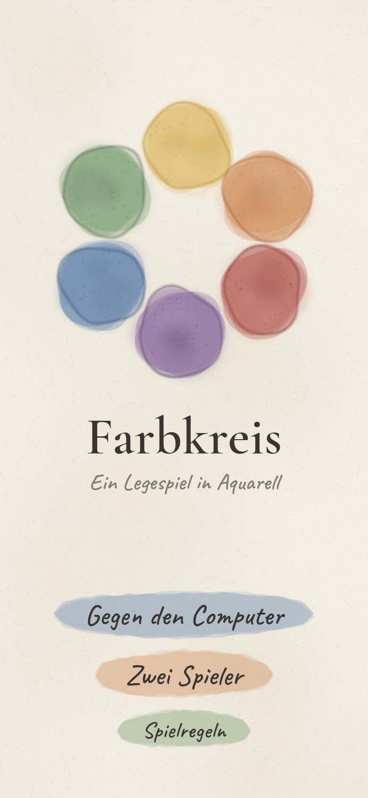
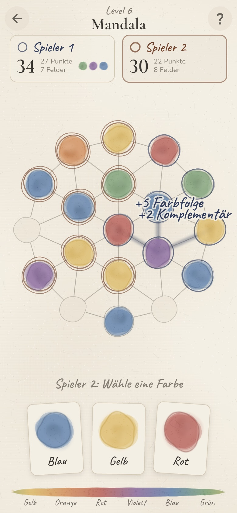
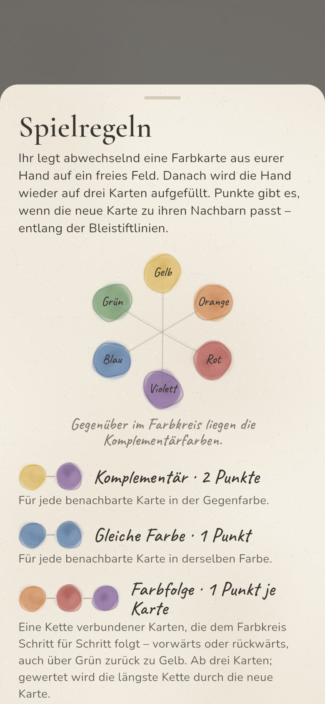
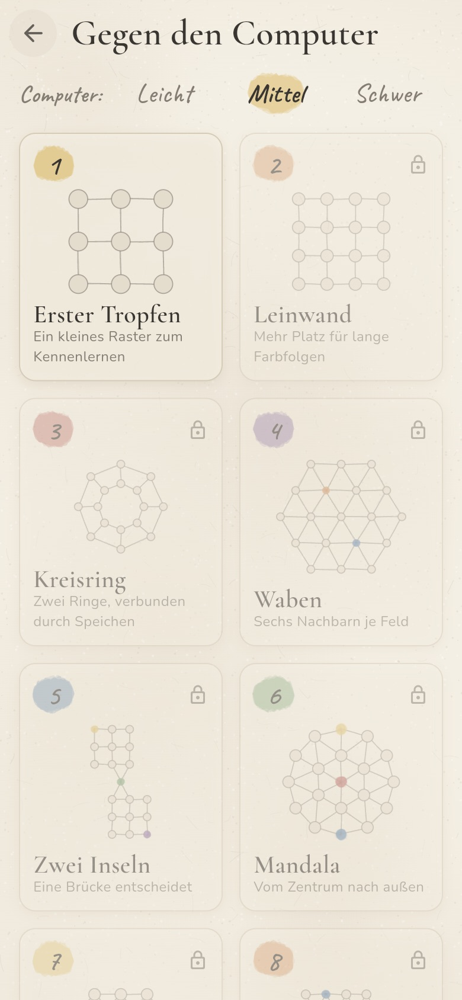
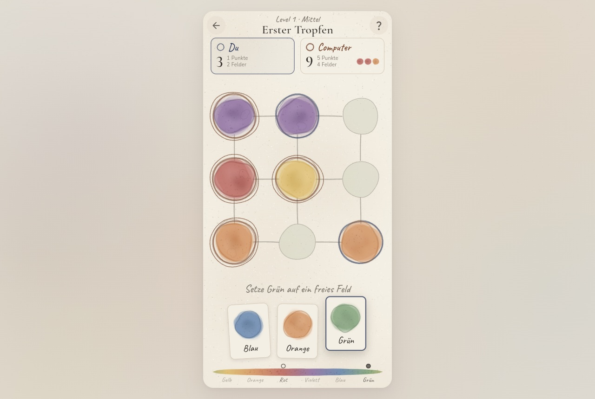

# Farbkreis

**Ein Legespiel in Aquarell.** Zwei Spieler legen abwechselnd Farbkarten auf ein Netz aus Feldern und punkten mit Farben, die im Farbkreis zusammengehören: gleiche Farben, Komplementärfarben und Farbfolgen.

**Spielen:** https://paszin.github.io/color-wheel-game/

<p align="center">
  
  
  
</p>

Gebaut mit Flutter und Flame, läuft im Browser, auf iOS, Android und macOS. Die Spielmechanik ist vom Google Doodle [Rise of the Half Moon](https://doodles.google/doodle/rise-of-the-half-moon/) inspiriert. Statt Mondphasen gibt es hier die Farben des Farbkreises.

## Spielregeln

Jeder Spieler hält drei Farbkarten. Wer am Zug ist, legt eine davon auf ein freies Feld und zieht nach. Punkte gibt es, wenn die neue Karte zu den Nachbarn passt, also zu den Feldern, die über eine Bleistiftlinie mit ihr verbunden sind.

Der Farbkreis hat sechs Farben: **Gelb → Orange → Rot → Violett → Blau → Grün** und dann wieder Gelb. Gegenüberliegende Farben sind komplementär: Gelb–Violett, Orange–Blau, Rot–Grün.

| Wertung | Punkte |
|---|---|
| **Komplementär**: Nachbar in der Gegenfarbe | 2 je Nachbar |
| **Gleiche Farbe**: Nachbar in derselben Farbe | 1 je Nachbar |
| **Farbfolge**: Kette verbundener Karten, die dem Farbkreis Schritt für Schritt folgt (vorwärts oder rückwärts, auch über Grün zurück zu Gelb), ab 3 Karten | 1 je Karte |
| **Voller Farbkreis**: Die Farbfolge enthält alle sechs Farben | +3 Bonus |

Gewertet wird die längste Farbfolge durch die neue Karte.

**Felder erobern:** Jede gelegte Karte gehört zunächst vorläufig dem Spieler, der sie gelegt hat (blasser Ring). Wer als Erstes mit einer Karte punktet, sichert sie sich (kräftiger Ring), auch wenn sie vorher dem Gegner gehörte. Gesicherte Felder wechseln nicht mehr den Besitzer. Die Punkte gibt es trotzdem voll: Macht Spieler 1 mit Gelb–Orange–Rot 3 Punkte und Spieler 2 legt Violett an, bekommt Spieler 2 alle 4 Punkte der Farbfolge, aber nur das neue Feld, nicht die drei schon gesicherten. Ein einfacher Ring steht für Spieler 1, ein doppelter für Spieler 2.

**Spielende:** Sind alle Felder bemalt, zählt **Punkte + eigene Felder**. Wer mehr hat, gewinnt.

**Nachziehen:** Farben, die schon auf der Hand sind, kommen seltener nach (Gewicht 1 / (1 + 3 · Anzahl)). So hat man selten zweimal dieselbe Farbe.

## Modi und Level

<p align="center">
  
</p>

- **Gegen den Computer:** acht Level. Jeder Sieg schaltet das nächste frei. Der Computer lässt sich auf **Leicht**, **Mittel** oder **Schwer** stellen. Auf Mittel wird er von Level zu Level stärker, auf Schwer spielt er überall fast optimal und blockiert Felder, auf denen du sofort punkten könntest.
- **Zwei Spieler:** abwechselnd am selben Gerät, alle Level frei wählbar.

| # | Brett | Besonderheit |
|---|---|---|
| 1 | Erster Tropfen | 3 × 3 Raster |
| 2 | Leinwand | 4 × 4 Raster |
| 3 | Kreisring | zwei Ringe, verbunden durch Speichen |
| 4 | Waben | Sechseckgitter mit sechs Nachbarn je Feld |
| 5 | Zwei Inseln | zwei Gruppen, eine Brücke dazwischen |
| 6 | Mandala | Zentrum mit zwei Ringen |
| 7 | Mosaik | Raster mit diagonalen Nachbarn |
| 8 | Pinselstrich | großes Brett mit versetzten Reihen |

Ab Level 4 liegen einzelne neutrale Karten schon zu Beginn auf dem Brett.

## Gestaltung

Die Grafik im Spiel wird beim Zeichnen aus Code erzeugt, ohne Bilddateien. Jede Farbfläche besteht aus mehreren durchscheinenden Lasuren mit unregelmäßigem Rand, dunklerem Pigment am Rand, Nass-in-Nass-Flecken und Granulation. Dazu kommen ein Papiergrund mit Fasern und Bleistiftlinien für die Verbindungen. Die sechs Farben sind gedämpfte Pigmenttöne statt reiner Bildschirmfarben.

Unten im Spiel zeigt ein Farbstreifen die Reihenfolge des Farbkreises. Ist eine Karte gewählt, markiert er ihre Farbe und die Komplementärfarbe.

Auf breiten Bildschirmen liegt das Spiel als Papierbogen mittig auf einem ruhigen Hintergrund:

<p align="center">
  
</p>

## Entwicklung

Voraussetzung ist Flutter 3.47 (Dart 3.13).

```bash
flutter pub get
flutter run -d chrome          # im Browser starten, mit Hot Reload
flutter test                   # Wertung, Kartenziehen, Computergegner, Schwierigkeit
flutter build web --release    # Ergebnis in build/web
```

### Aufbau

| Pfad | Inhalt |
|---|---|
| `lib/model/board.dart` | Spielbrett als Graph: Felder mit Farbe, Besitzer und Nachbarn |
| `lib/model/levels.dart` | die acht Bretter (Raster, Ringe, Sechseckgitter, …) |
| `lib/logic/scoring.dart` | Wertung eines Zugs, inklusive Suche nach der längsten Farbfolge |
| `lib/logic/game_state.dart` | Spielablauf: Züge, Übernehmen, Hand, Endstand |
| `lib/logic/ai.dart`, `difficulty.dart` | Computergegner und Schwierigkeitsstufen |
| `lib/painting/watercolor.dart` | Aquarell-Rendering: Farbflächen, Papier, Bleistift, Pinselstriche |
| `lib/game/color_wheel_game.dart` | Flame-Darstellung des Bretts mit Animationen |
| `lib/ui/` | Screens: Menü, Levelauswahl, Spiel, Regeln |
| `test/` | Unit-Tests |

Die Spiellogik (`model/`, `logic/`) kommt ohne Oberfläche aus und wird direkt in den Unit-Tests geprüft.

### Veröffentlichung

Die GitHub Action [`.github/workflows/deploy-pages.yml`](.github/workflows/deploy-pages.yml) läuft bei jedem Push auf `main`. Sie prüft den Code (`flutter analyze`, `flutter test`), baut die Web-Version und veröffentlicht sie im Branch `gh-pages`. GitHub Pages muss einmalig unter **Settings → Pages → Deploy from a branch → `gh-pages` / (root)** eingestellt sein.

## Schriften

Cormorant Garamond, Caveat und Nunito liegen in `assets/fonts/` und stehen unter der SIL Open Font License.
